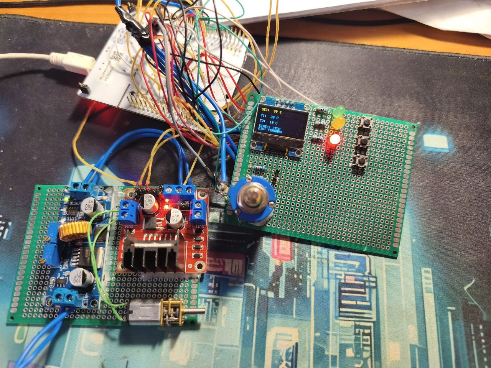

# STM32 DC Motor Controller

A DC motor control system based on the **STM32 NUCLEO-F401RE**.

The project demonstrates embedded motor control using hardware PWM, ADC measurements, an OLED user interface, physical buttons, status LEDs, temperature monitoring, UART diagnostics, and an external H-bridge motor driver.

## Project Prototype



The current prototype includes:

- STM32 NUCLEO-F401RE
- L298N H-bridge motor driver
- XL4015 DC-DC converter
- DC geared motor
- SSD1306 128x64 OLED display
- 10 kΩ potentiometer
- Two NTC 10 kΩ B3950 temperature sensors
- RUN / STOP / DIR buttons
- Green, yellow and red status LEDs

## Demo Video

A demonstration of the working prototype is available on YouTube:

[](https://youtu.be/9c_M-3-IXv4)

[▶ Watch the demo on YouTube](https://youtu.be/9c_M-3-IXv4)

## Features

- Hardware PWM motor speed control
- Potentiometer-based speed setpoint from 0 to 100%
- RUN and STOP motor control
- Forward / Reverse direction control
- SSD1306 128x64 OLED interface over I2C
- Two NTC 10 kΩ B3950 temperature sensors
- ADC data acquisition
- Three physical push buttons
- Three status LEDs
- UART diagnostics through ST-LINK Virtual COM Port
- L298N H-bridge motor driver
- External XL4015 DC-DC converter
- Common-ground power architecture

## Hardware

- **MCU board:** STM32 NUCLEO-F401RE
- **Motor driver:** L298N
- **DC-DC converter:** XL4015 CC/CV
- **Motor:** DC geared motor
- **Display:** SSD1306 128x64 I2C OLED
- **Speed input:** 10 kΩ potentiometer
- **Temperature sensors:** 2 × NTC 10 kΩ B3950
- **Controls:** 3 × push buttons
- **Indicators:** Green, yellow and red LEDs
- **Power supply:** 12 V external power supply

## Pinout

| Function         | STM32 Pin      | NUCLEO Pin |
| ---------------- | -------------- | ---------- |
| Potentiometer    | PA0            | A0         |
| NTC1             | PA1            | A1         |
| NTC2             | PA4            | A2         |
| Motor PWM / ENB  | PB3 / TIM2_CH2 | D3         |
| Green LED        | PB5            | D4         |
| Yellow LED       | PB4            | D5         |
| Red LED          | PB10           | D6         |
| RUN button       | PA8            | D7         |
| STOP button      | PA9            | D8         |
| Direction button | PC7            | D9         |
| L298N IN3        | PA7            | D11        |
| L298N IN4        | PA6            | D12        |
| OLED SDA         | PB9            | D14        |
| OLED SCL         | PB8            | D15        |

## Motor Control

The motor uses channel B of the L298N driver.

```text
STM32 D3 / PB3  -> L298N ENB
STM32 D11 / PA7 -> L298N IN3
STM32 D12 / PA6 -> L298N IN4

L298N OUT3 -> DC Motor
L298N OUT4 -> DC Motor
```

`TIM2_CH2` generates the hardware PWM signal used for motor speed control.

The potentiometer provides a speed setpoint from **0% to 100%**.

When the motor is stopped, the PWM duty cycle is set to zero and both direction inputs are disabled.

Before changing the rotation direction, PWM is temporarily disabled to reduce stress on the motor and driver.

## Controls

### RUN

Starts the motor using the speed selected by the potentiometer.

### STOP

Stops the motor and disables the L298N direction inputs.

### DIR

Changes the motor direction between:

- Forward
- Reverse

## Status LEDs

- **Green** — motor is running
- **Red** — motor is stopped
- **Yellow** — reverse direction is selected

## Temperature Monitoring

Two NTC 10 kΩ B3950 thermistors are connected to ADC inputs using voltage dividers.

```text
3.3 V
  |
10 kΩ
  |
  +---- ADC input
  |
NTC 10 kΩ
  |
 GND
```

The firmware converts the ADC measurements into temperature values in degrees Celsius.

## OLED Display

The SSD1306 display is connected over I2C.

```text
OLED SDA -> PB9 / D14
OLED SCL -> PB8 / D15
OLED VCC -> 3.3 V
OLED GND -> GND
```

The display shows:

- Speed setpoint
- Temperature sensor 1
- Temperature sensor 2
- Motor state
- Motor direction

Example:

```text
SET: 65 %
T1: 24 C
T2: 23 C
STATE: RUN
DIR: FORWARD
```

## UART Diagnostics

USART2 is used for debugging and monitoring through the ST-LINK Virtual COM Port.

Configuration:

```text
Baud rate: 115200
Data bits: 8
Parity: None
Stop bits: 1
Flow control: None
```

Example output:

```text
SET=65 PWM=64 T1=24 C T2=23 C STATE=RUN DIR=FORWARD
```

## Power System

The motor power supply is separated from the STM32 logic supply.

```text
12 V Power Supply
        |
        v
   XL4015 DC-DC
        |
        | ~7 V
        v
      L298N
        |
        v
     DC Motor
```

The STM32, L298N and XL4015 use a **common ground**.

The L298N `+5V` output is not used to power the NUCLEO board.

## Hardware Schematic

The complete project schematic is available as a PDF:

[📄 Open Motor Controller Schematic](Hardware/motor.pdf)

The schematic includes:

- STM32 NUCLEO-F401RE connections
- OLED interface
- Potentiometer
- NTC sensor circuits
- Push buttons
- Status LEDs
- L298N motor driver
- XL4015 power converter
- DC motor
- External power supply

## Software

The firmware was developed using:

- STM32CubeMX
- STM32CubeIDE
- STM32 HAL
- C
- Altium Designer

## STM32 Peripherals

The project uses the following STM32 peripherals:

- **ADC1** — potentiometer and NTC sensors
- **TIM2 CH2** — motor PWM
- **I2C1** — SSD1306 OLED
- **USART2** — UART diagnostics
- **GPIO** — buttons, LEDs and L298N direction control

## Project Structure

```text
STM32-DC-Motor-Controller/
│
├── Core/
│   ├── Inc/
│   └── Src/
│
├── Drivers/
│
├── Hardware/
│   └── motor.pdf
│
├── Images/
│   └── motor1.jpg
│
├── Motor_Controller.ioc
├── README.md
├── LICENSE
└── .gitignore
```

## Project Status

Current version: **v0.1 — Working Prototype**

### Implemented

- [x] ADC acquisition
- [x] Potentiometer speed input
- [x] NTC temperature measurement
- [x] SSD1306 OLED interface
- [x] RUN / STOP control
- [x] Forward / Reverse control
- [x] Hardware PWM motor speed control
- [x] L298N motor driver
- [x] UART diagnostics
- [x] Status LEDs
- [x] External motor power system
- [x] Hardware schematic
- [x] Working physical prototype
- [x] Demo video

### Planned

- [ ] RS485 communication
- [ ] Modbus RTU
- [ ] Motor RPM measurement
- [ ] Closed-loop speed control
- [ ] PID controller
- [ ] FreeRTOS integration

## Future Development

Future versions of the project are planned to include an RS485 communication interface with Modbus RTU.

Motor RPM feedback can then be added to implement closed-loop speed regulation using a PID controller.

The project can also be migrated to FreeRTOS, separating functionality into independent tasks such as:

- ADC acquisition
- OLED update
- Motor control
- UART / RS485 communication
- Temperature monitoring

## License

This project is licensed under the **MIT License**.

See the [LICENSE](LICENSE) file for details.
